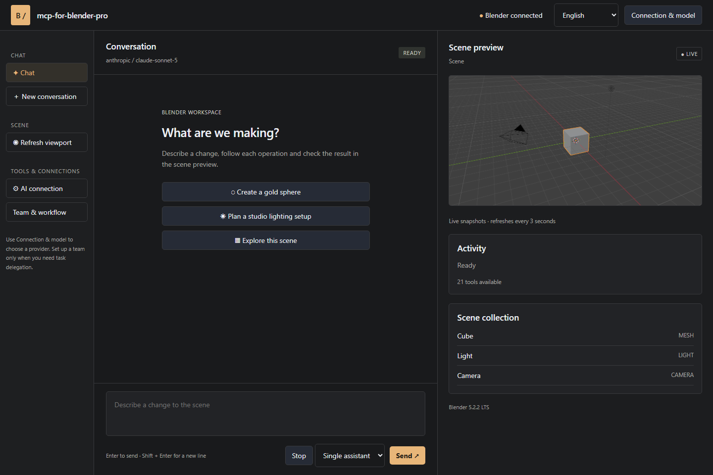
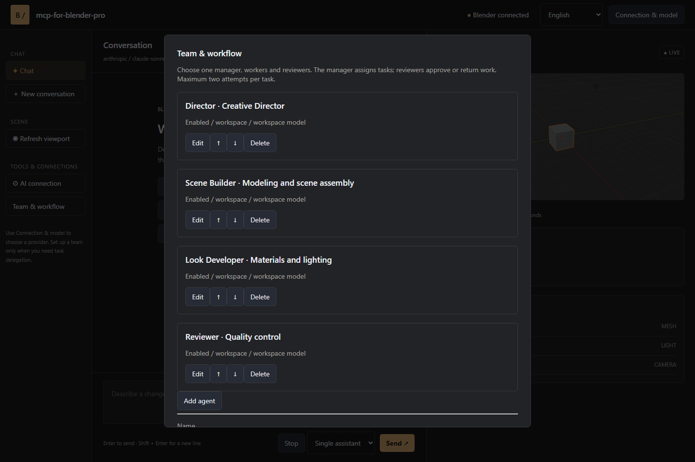
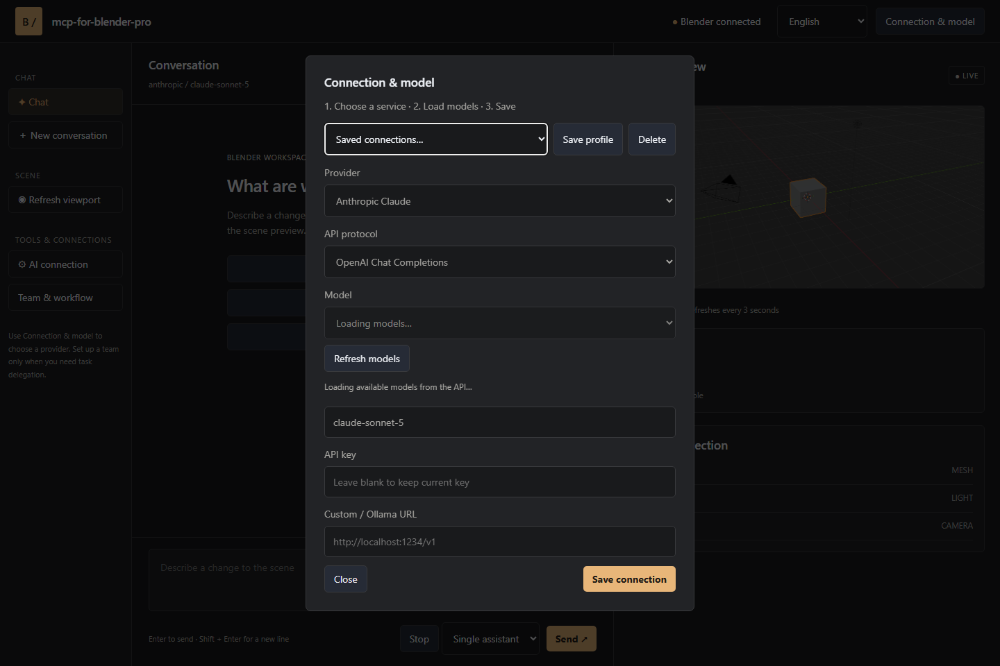

# mcp-for-blender-pro

### Your Blender scene. Your AI models. One creative workspace.

**An AI assistant for Blender that can inspect your scene, build objects, edit materials, find assets and carry out multi-step workflows—with a visual chat workspace and a built-in Model Context Protocol (MCP) server.**

[Download](../../releases/latest) · [Getting started](docs/QUICKSTART.md) · [Connections and agents](docs/CONNECTIONS.md)

## Turn a creative brief into scene operations

Start with an idea. Ask the assistant to inspect your scene, create a product-display layout, arrange objects, assign materials or prepare an export. Follow its actions in the conversation and inspect the result in the viewport preview. Keep working in Blender throughout the process.

**mcp-for-blender-pro brings conversation, scene tools, model choice and agent workflows together.** It is designed for artists who want faster iteration, technical artists who automate repetitive work, and developers connecting AI tools to Blender.

## Why choose mcp-for-blender-pro?

| Capability | What it gives you |
|---|---|
| **Blender-aware assistance** | Scene and object inspection gives the assistant context before it acts. |
| **A visual Studio workspace** | Chat, scene objects, viewport snapshots, approvals and a task board in a companion window. |
| **Your choice of AI** | Connect supported cloud providers, local Ollama models or compatible custom endpoints. |
| **Saved connections** | Keep work and personal connections separate, including multiple keys for the same provider. |
| **One assistant or a team** | Use a single model for quick changes, or managers, workers and reviewers for structured tasks. |
| **Built-in MCP server** | Connect OpenCode and other clients supporting authenticated Streamable HTTP MCP. |
| **21 scene tools** | Create, inspect, edit, capture, search assets, consult Blender APIs and export scenes. |
| **Multilingual menus** | Choose English, German, French, Spanish or Chinese for the main interface. |

## From a quick edit to an agent team

Use **Single assistant** for direct, conversational work. For larger tasks, configure a **Team chain** with individual responsibilities, instructions and models.

- **Manager:** breaks the request into assignments and acceptance criteria.
- **Workers:** perform the assigned scene operations.
- **Reviewers:** inspect results and approve work or return specific findings.

Tasks run sequentially so scene edits stay ordered. A blocked task gets one correction attempt; a second failed review stops the workflow. The task board exposes assignments, attempts and review findings as work progresses.

## Connect the models that fit your work

Supported connections include **OpenAI, Anthropic Claude, Google Gemini, OpenRouter, OpenCode Zen, Ollama and custom APIs**. Load the available model catalog and select a model directly in Blender or Studio.

Custom endpoints support OpenAI Chat Completions, Anthropic Messages and Ollama protocols. Choose models with tool-calling support; image-capable models can also interpret viewport screenshots. OpenCode-only free models are available through the OpenCode client.

## Install and create

1. Download **`mcp-for-blender-pro.zip`** from [Releases](../../releases/latest).
2. In Blender, open **Edit → Preferences → Get Extensions → menu → Install from Disk**.
3. Select the ZIP, enable **mcp-for-blender-pro**, then open **3D Viewport → N → MCP Pro**.
4. Choose a provider, add your connection details and select a model.
5. Send a message in Blender or click **Open Studio Window**.

The release bundle targets **Windows x64 with Blender 4.2 or later**. Keep Blender open while using Studio or an external client.

### Try these prompts

> Inspect this scene and explain its object structure before making any changes.

> Create a simple product-display scene with a pedestal, a camera and three lights. Give the pedestal a matte blue material.

> Duplicate the selected object into a neatly spaced row of five and show the viewport.

> Find an appropriate Poly Haven asset for this scene and ask before importing it.

## Blender automation through MCP

Launch **OpenCode Portable** from the sidebar to work through OpenCode with the Blender connection configured for you. OpenCode manages its own provider sign-in and model selection. Other compatible MCP clients can connect to the authenticated local endpoint described in the [connection guide](docs/CONNECTIONS.md).

| Tool group | Included tools |
|---|---|
| Scene inspection | `get_scene_info`, `list_objects`, `get_object_info` |
| Object creation | `add_cube`, `add_sphere`, `add_cylinder`, `add_plane`, `add_light`, `add_camera` |
| Editing | `move_object`, `duplicate_object`, `delete_object`, `parent_objects`, `set_material` |
| Visual feedback and scripting | `viewport_screenshot`, `execute_code` |
| Blender API and export | `bpy_api_lookup`, `describe_node_type`, `export_scene` |
| Asset workflows | `search_assets`, `import_asset` |

Asset integrations include **Poly Haven, Sketchfab and Poly Pizza**. Configure service keys where required and follow the licenses of the assets you use.

## Stay in control of your scene

Built-in chat supports operation approvals, cancellation after the current step and named undo steps for mutations. Python tool validation helps catch disallowed operations; it is not a security sandbox. External MCP clients manage their own approval policies.

Connection credentials are stored in your user settings. Chat history lasts for the current session. Studio runs locally and authenticates requests to Blender.

## Keywords

mcp-for-blender · blender mcp server · blender mcp · blender ai · ai for blender · blender ai assistant · blender chatgpt · blender claude · blender openai · blender gemini · blender llm · blender ollama · blender agents · blender multi-agent · blender copilot · ai blender addon · blender extension · blender addon · blender plugin · blender automation · blender scripting · blender python · bpy api · blender api · geometry nodes · 3d modeling · 3d automation · 3d workflow · scene generation · ai modeling · ai materials · ai textures · viewport screenshot · model context protocol · mcp integration · opencode blender · ai tools for blender · blender workflow · chat in blender · ai chat blender

## License

Released under the MIT license. OpenCode's license is included with the distribution. Independent project; not affiliated with or endorsed by the Blender Foundation or the listed AI providers.
